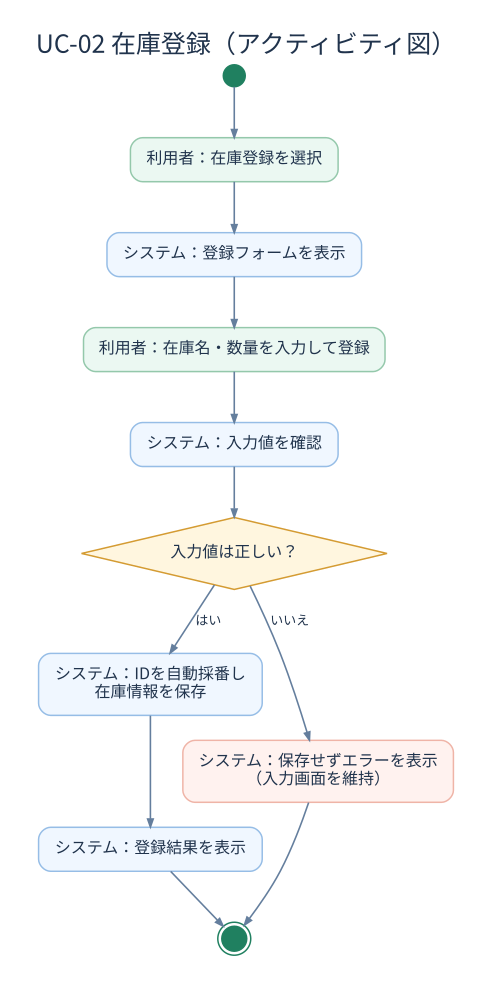
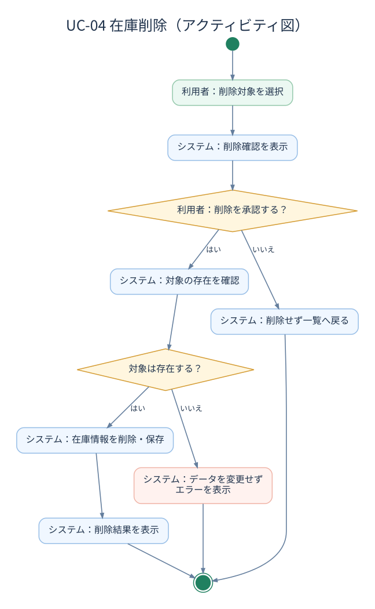

# アクティビティ図

[ユースケース仕様書](../requirements/use-cases.md)のイベントフローに基づき、在庫登録と在庫削除の流れを図示する。

## 1. 在庫登録（UC-02）

入力条件を満たさない場合は保存せず、エラーを表示する。

[編集用（PlantUML）](diagrams/activity-create.puml)

## 2. 在庫削除（UC-04）

削除キャンセル時と対象が存在しない場合は、データを変更しない。

[編集用（PlantUML）](diagrams/activity-delete.puml)
