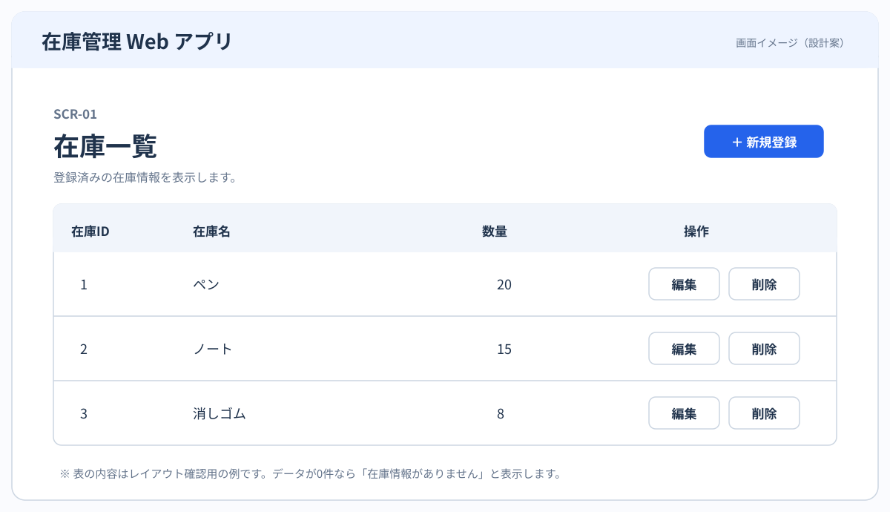
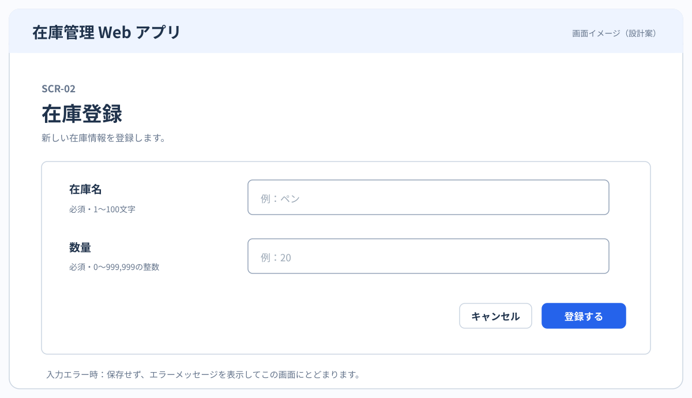
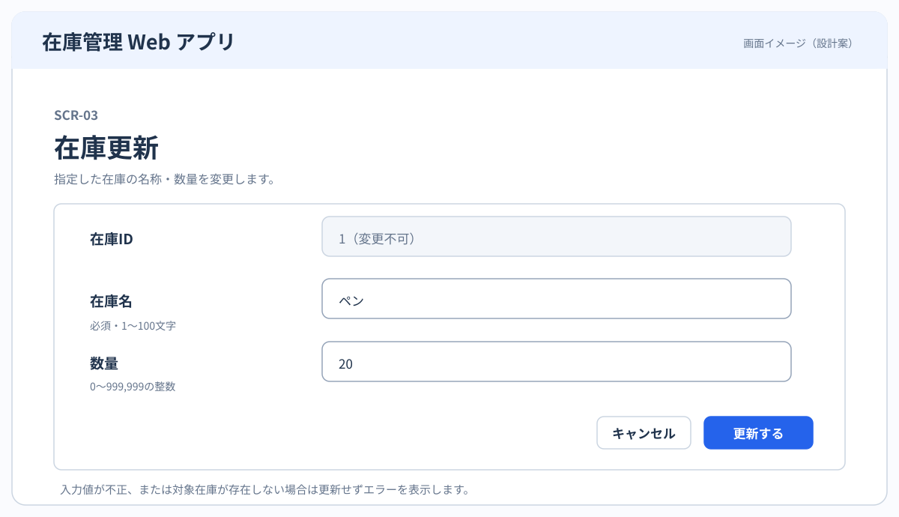
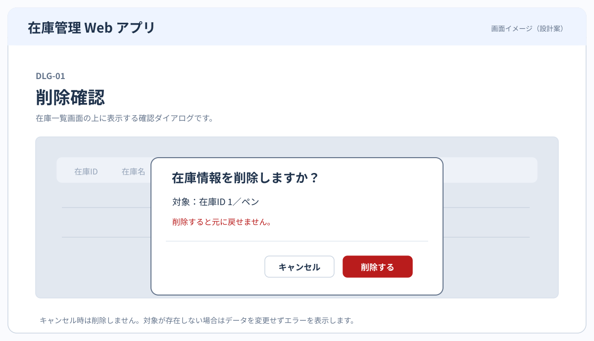

# 画面仕様書

[要件定義書](../requirements/requirements-definition.md)・[ユースケース仕様書](../requirements/use-cases.md)・[画面遷移図](screen-transition.md)に基づいて画面仕様を定義する。

## 1. 画面一覧

| ID | 画面名 | 対応機能 |
|---|---|---|
| SCR-01 | 在庫一覧 | FR-01 |
| SCR-02 | 在庫登録 | FR-02・FR-05・FR-06 |
| SCR-03 | 在庫更新 | FR-03・FR-05・FR-06 |
| DLG-01 | 削除確認 | FR-04・FR-05・FR-06 |

## 2. ワイヤーフレーム

### SCR-01 在庫一覧

- 表示項目：在庫ID、在庫名、数量。各行に「編集」「削除」、画面に「新規登録」を設ける。
- 新規登録はSCR-02、編集はSCR-03、削除はDLG-01を開く。
- 在庫が0件の場合は「在庫情報がありません」と表示する。

### SCR-02 在庫登録

- 入力項目：在庫名（1〜100文字）、数量（0〜999,999の整数）。いずれも必須。
- 「登録する」で入力を確認し、正常時は保存してSCR-01へ戻る。
- 不正入力時は保存せずエラーを表示して画面にとどまる。「キャンセル」は保存せずSCR-01へ戻る。
- 在庫IDはシステムが自動採番するため入力させない。

### SCR-03 在庫更新

- 表示項目：在庫ID（変更不可）。入力項目：在庫名・数量（SCR-02と同じ条件）。
- 選択した在庫の現在値を初期表示する。
- 「更新する」で対象の存在と入力値を確認し、正常時は保存してSCR-01へ戻る。
- 入力エラーや対象が存在しない場合は変更せずエラーを表示する。「キャンセル」は変更せずSCR-01へ戻る。

### DLG-01 削除確認

- SCR-01で選択した在庫のID・名称を表示し、削除の実行を確認する。
- 「削除する」で対象の存在を確認して削除・保存し、SCR-01へ戻る。
- 「キャンセル」では削除せずSCR-01へ戻る。対象が存在しない場合も変更しない。

※ 図中の在庫データはサンプル
