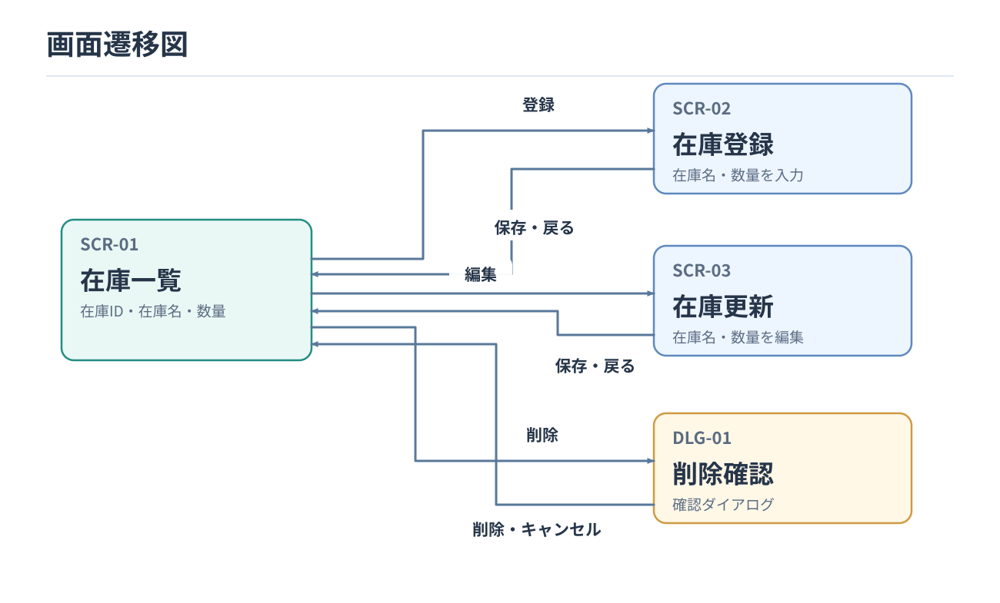

# 画面一覧・画面遷移設計書

要件定義書とユースケース仕様書に基づき、画面構成と画面遷移を整理する。

## 1. 画面一覧

| 画面ID | 画面名 | 主な用途 | 対応UC |
|---|---|---|---|
| SCR-01 | 在庫一覧 | 在庫の一覧表示、登録・更新・削除の操作 | UC-01 |
| SCR-02 | 在庫登録 | 在庫名・数量の入力と登録 | UC-02 |
| SCR-03 | 在庫更新 | 在庫名・数量の変更 | UC-03 |
| DLG-01 | 削除確認 | 在庫削除の実行・キャンセル | UC-04 |

※ DLG-01は在庫一覧から表示する確認ダイアログとする。

## 2. 画面遷移図

登録・更新が成功した場合は在庫一覧へ戻る。入力エラー時は入力画面にとどまり、削除をキャンセルした場合は在庫一覧へ戻る。
