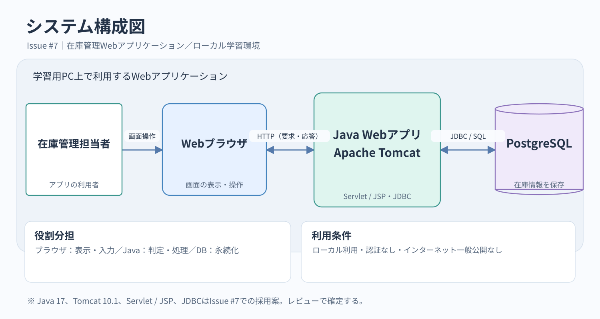

# システム構成設計書

**対応Issue：** [#7 システム構成を設計する](https://github.com/polyfortrain/inventory-app/issues/7)  
**参照：** [要件定義書](../requirements/requirements-definition.md)／[ユースケース仕様書](../requirements/use-cases.md)

## 1. システム構成図

[構成図の編集用ファイル（draw.io）](diagrams/system-architecture.drawio)

## 2. 構成要素

| 構成要素 | 役割 | 採用方針 |
|---|---|---|
| Webブラウザ | 在庫情報の表示、利用者の入力・操作 | ローカルPCからアクセスする |
| Java Webアプリケーション | CRUD、入力チェック、操作結果の生成 | Servlet / JSPを採用する案 |
| Webアプリケーションサーバー | Java Webアプリケーションを実行する | Apache Tomcat 10.1を採用する案 |
| PostgreSQL | 在庫ID・在庫名・数量の永続化 | 要件定義書で使用が決まっている |
| JDBCドライバー | Java WebアプリケーションからDBに接続する | PostgreSQL JDBCドライバーを使用する案 |

Javaの実行環境は **Java 17** を採用候補とする。Tomcat 10.1はJava 11以降に対応し、Jakarta Servlet 6.0 / Pages 3.1を実装するため、Servletの名前空間は `jakarta.servlet` とする（技術選定が確定した場合）。

> **設計上の位置づけ：** 要件定義書で確定している技術はJavaとPostgreSQLである。Java 17、Tomcat 10.1、Servlet / JSP、JDBCの組合せは、このIssueで提案する実現方式であり、レビューで確定する。

## 3. 基本的な処理の流れ

1. 利用者がブラウザで在庫一覧・登録・更新・削除を要求する。
2. ブラウザがJava WebアプリケーションにHTTPリクエストを送る。
3. アプリケーションが必要な入力確認を行い、JDBC経由でPostgreSQLの在庫情報を参照・変更する。
4. アプリケーションが結果またはエラーメッセージを返し、ブラウザに表示する。

一覧表示は **FR-01**、登録・更新・削除は **FR-02〜FR-04** に対応する。不正入力や存在しない在庫IDではデータを変更しない（**FR-05**）。登録・更新・削除の結果は保存し、画面再表示後も反映する（**FR-06**）。

## 4. 利用条件・設計上の制約

- **利用範囲：** 学習用PC上のローカル環境に限定し、インターネット上では一般公開しない。
- **対象外：** ログイン、検索、入出庫履歴などは設けない。
- **接続構成：** ブラウザはPostgreSQLに直接接続せず、Java Webアプリケーションを介してアクセスする。
- **設計の分担：** 画面配置・詳細な画面遷移は画面設計、クラスとDAOなどの内部構造は内部設計、テーブルのデータ型・制約はDB設計で確定する。

## 5. レビュー時の確認事項

- 使用技術の採用案（Java 17 / Tomcat 10.1 / Servlet・JSP / JDBC）で進めてよいか。
- 要件定義書とユースケース仕様書の機能・利用条件に矛盾がないか。

**参考：** [Apache Tomcat 10.1の仕様](https://tomcat.apache.org/tomcat-10.1-doc/index.html)、[Tomcat 10.1移行ガイド](https://tomcat.apache.org/migration-10.1.html)
