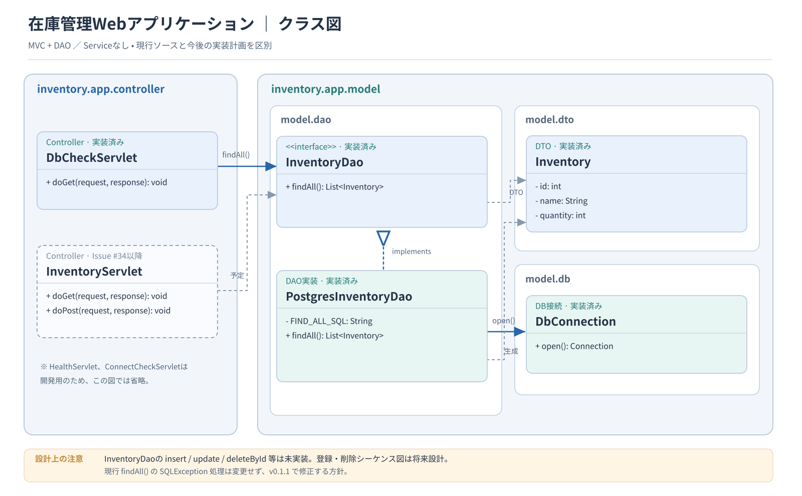

# Javaクラス設計書

[システム構成設計書](../external-design/system-architecture.md)と[ユースケース仕様書](../requirements/use-cases.md)をもとに、Java Webアプリケーションの主要クラスを設計する。

## 1. クラス図

## 2. クラスの役割

| クラス・インターフェース | 主な役割 |
|---|---|
| `Inventory` | 在庫ID・在庫名・数量を保持する |
| `InventoryServlet` | HTTPリクエストを受け付け、画面へ結果を渡す |
| `InventoryService` | 入力検証とCRUDの処理を行う |
| `InventoryDao` | 在庫情報の取得・保存・更新・削除を定義する |
| `JdbcInventoryDao` | JDBCを使ってPostgreSQLにアクセスする |

- 画面表示にはJSPを使用する案とし、JSPはクラス図に含めない。
- 在庫名は1〜100文字、数量は0〜999,999の整数とし、入力値の妥当性を`InventoryService`で確認する（FR-05）。
- 存在しない在庫IDへの更新・削除では、ほかのデータを変更しない。
- `JdbcInventoryDao`は[テーブル定義書](table-definitions.md)の`inventory`テーブルを使用する。