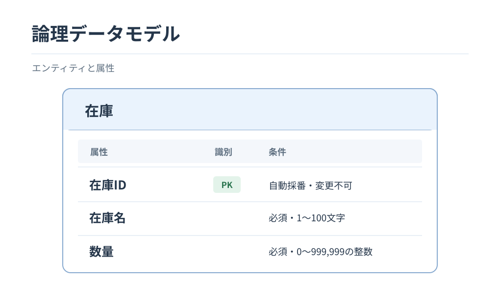

# 論理データモデル

[概念データモデル](../external-design/conceptual-data-model.md)をもとに、在庫情報の論理構造を定義する。

## 1. 論理DM図

## 2. 属性一覧

| エンティティ | 属性 | 条件 |
|---|---|---|
| 在庫 | 在庫ID | 識別子。自動採番・変更不可 |
| 在庫 | 在庫名 | 必須。1〜100文字 |
| 在庫 | 数量 | 必須。0〜999,999の整数 |

