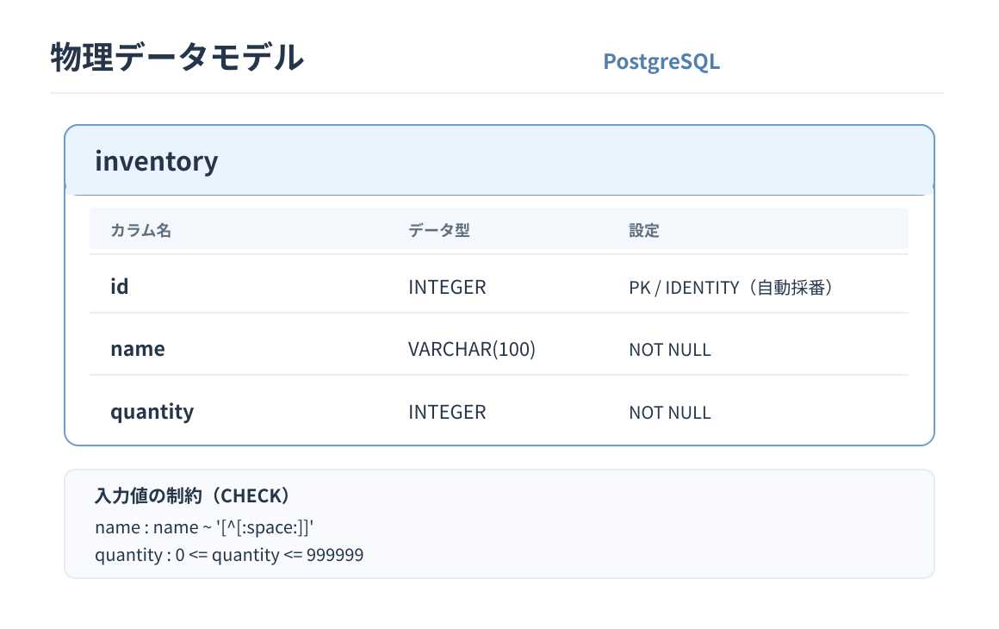

# 物理データモデル

[論理データモデル](logical-data-model.md)をもとに、PostgreSQLのテーブル構造を設計する。

## 1. 物理DM図

## 2. テーブル構成

テーブル名：`inventory`

| カラム | PostgreSQLデータ型 | 制約・設定 |
|---|---|---|
| `id` | `INTEGER` | 主キー・自動採番（`GENERATED ALWAYS AS IDENTITY`） |
| `name` | `VARCHAR(100)` | `NOT NULL`、空文字・空白のみの値を禁止するCHECK |
| `quantity` | `INTEGER` | `NOT NULL`、0〜999,999のCHECK |

- 在庫IDはシステムが割り当て、在庫名・数量は必須とする。
- 在庫名の重複を禁止する要件はないため、`UNIQUE`制約は追加しない。
- カラムの詳細な定義とDDLは[テーブル定義書のIssue #15](https://github.com/polyfortrain/inventory-app/issues/15)で確定する。
