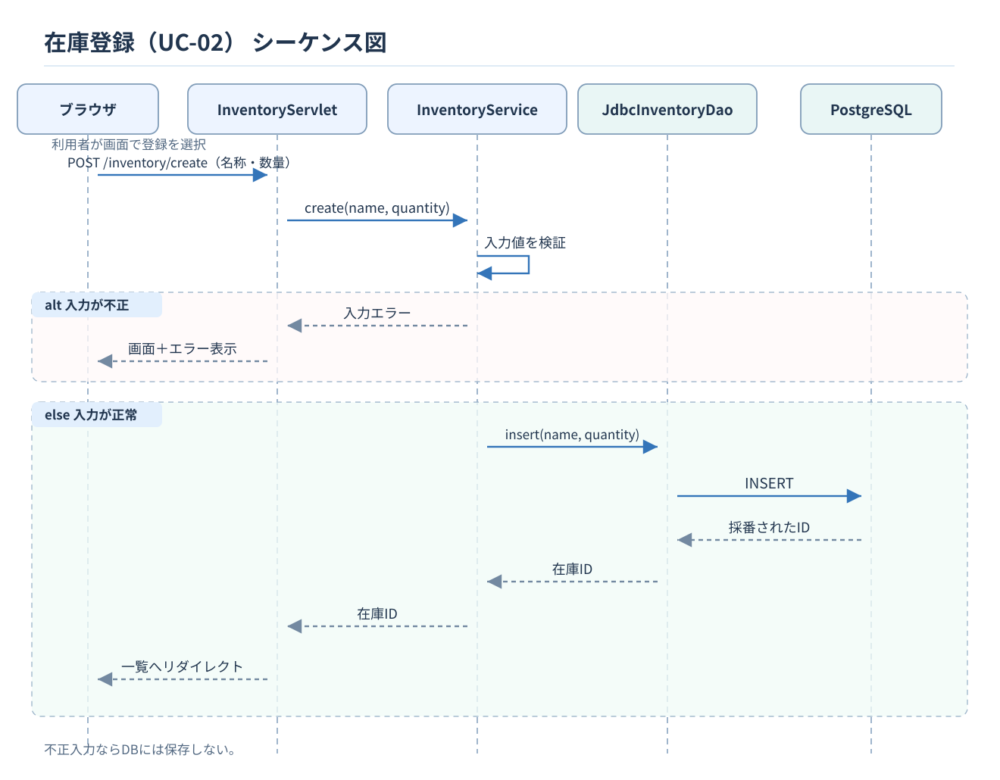
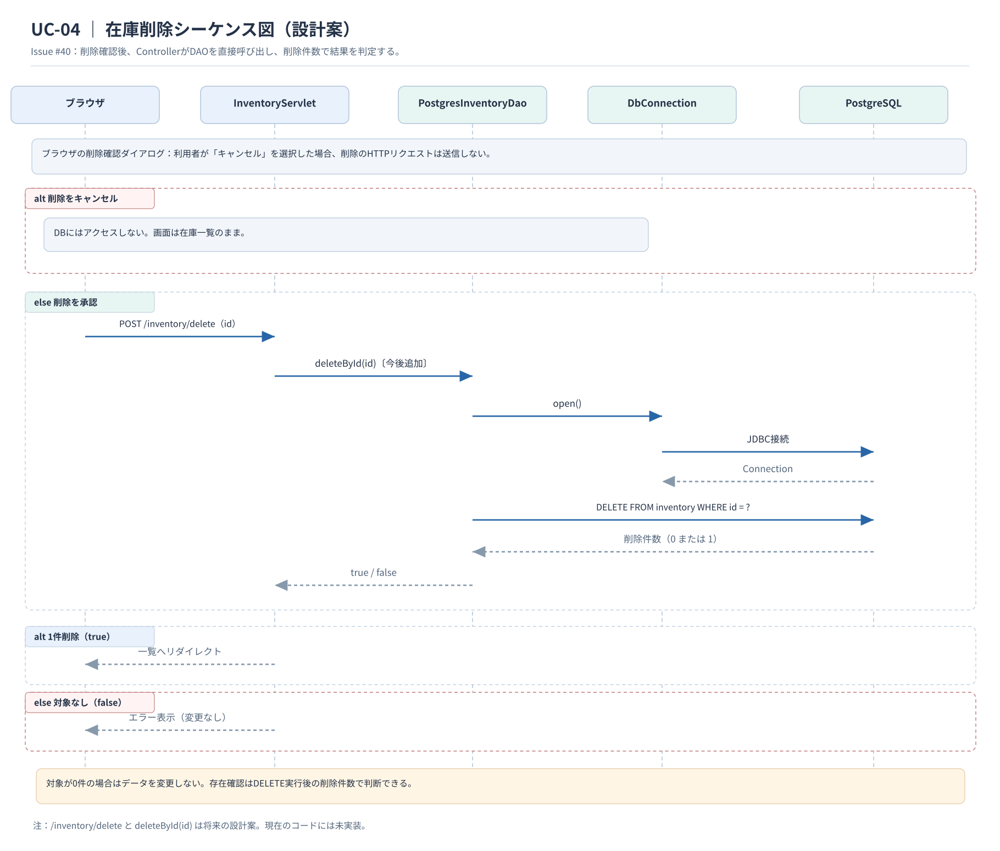

# シーケンス図

[ユースケース仕様書](../requirements/use-cases.md)、[アクティビティ図](../external-design/activity-design.md)、[クラス図](class-design.md)に基づき、在庫登録・在庫削除の処理を示す。

## 1. 在庫登録（UC-02）

入力が不正な場合は保存せず、エラーを表示する。正常に保存できた場合は在庫一覧へ戻る。

## 2. 在庫削除（UC-04）

削除をキャンセルした場合、削除リクエストを送信しない。対象の在庫が存在しない場合はデータを変更しない。