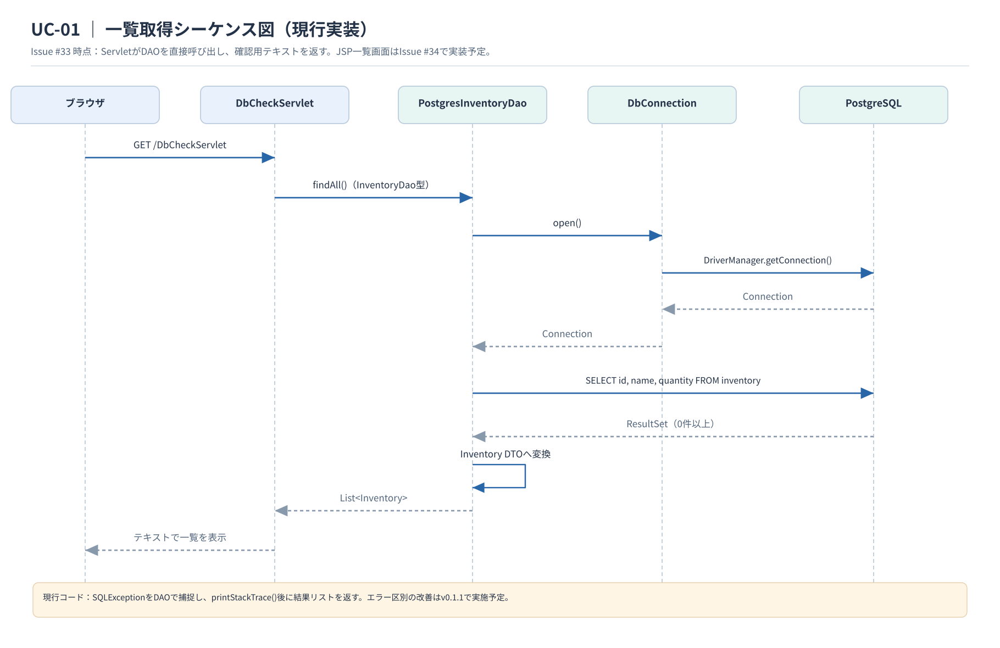

# シーケンス図

[ユースケース仕様書](../requirements/use-cases.md)、[アクティビティ図](../external-design/activity-design.md)、[クラス図](class-design.md)に基づき、現在の在庫一覧取得処理と、今後実装する在庫登録・削除の処理を示す。

**設計方針：** `InventoryService`を介さず、Servlet（Controller）が`InventoryDao`を直接呼び出す。`PostgresInventoryDao`はその実装クラスである。クラス図に記載されている構成に合わせる。

## 1. 在庫一覧取得（UC-01 / 現行実装）

[編集用（draw.io）](diagrams/sequence-list.drawio) ／ [編集用（PlantUML）](diagrams/sequence-list.puml)

現行の`DbCheckServlet`は、`PostgresInventoryDao.findAll()`を`InventoryDao`経由で呼び出し、取得した`Inventory`のリストをテキスト表示する。JSPによる正式な在庫一覧画面はIssue #34で実装する。

**既知の挙動：** 現行DAOは`SQLException`を内部で捕捉して結果リストを返すため、障害時も空一覧として扱われ得る。v0.1.1で修正予定とし、ここでは実装どおりに記載する。

## 2. 在庫登録（UC-02 / 設計案）

[編集用（draw.io）](diagrams/sequence-create.drawio) ／ [編集用（PlantUML）](diagrams/sequence-create.puml)

登録要求を受けた`InventoryServlet`が在庫名・数量を検証する（FR-05）。入力が不正なら登録せず、画面にエラーを表示する。正常ならDAOへ`insert()`を依頼し、保存後に在庫一覧へ戻る。

`InventoryServlet`とDAOの`insert()`は未実装であり、Issue #36で実装する。図中の`POST /inventory/create`は従来の設計で使用していた仮のURLで、実装時に決定する。

## 3. 在庫削除（UC-04 / 設計案）

[編集用（draw.io）](diagrams/sequence-delete.drawio) ／ [編集用（PlantUML）](diagrams/sequence-delete.puml)

削除をキャンセルした場合、削除要求を送信せず、データを変更しない。削除を承認した場合、`InventoryServlet`がDAOの`deleteById(id)`を呼び出す。DELETE文の実行件数が1なら成功、0なら対象なしとして扱い、他の在庫を変更しない。

`deleteById()`は未実装であり、Issue #40で実装する。図中の`POST /inventory/delete`は仮のURLである。

## 4. 実装時の注意

- 入力値の妥当性検証はControllerで行う。`Service`層は設けない。
- DAOはSQL実行と`Inventory` DTOへの変換を担当する。JSPからDAOを直接呼び出さない。
- 在庫名は1〜100文字、空白のみ不可、数量は0〜999,999の整数とする。
- 登録・削除が成功した場合は、画面再表示後も結果が保持される（FR-06）。
- 接続エラーと在庫0件を区別する改善は、v0.1.1の修正対象として別に扱う。
