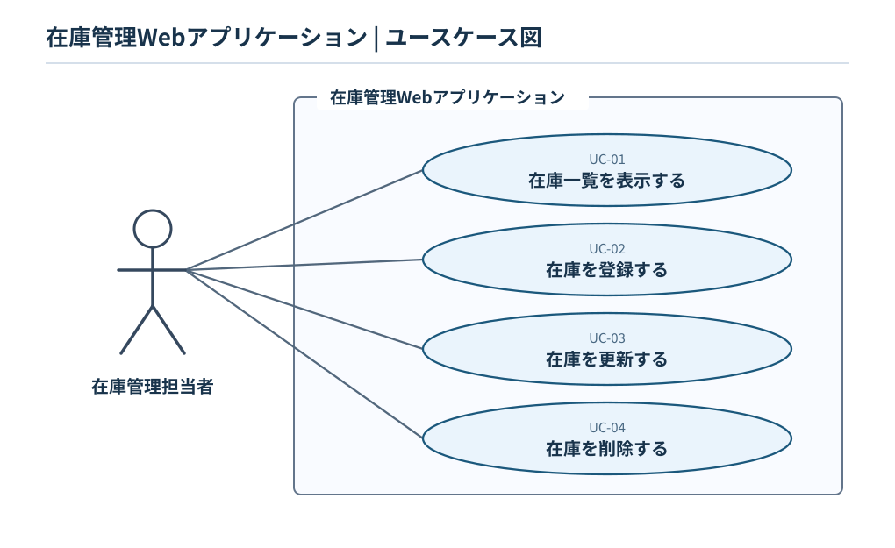

# ユースケース仕様書

- **対象システム：** 在庫管理Webアプリケーション（目標リリース v1.0.0）
- **対応Issue：** #3「ユースケースを整理する」
- **参照資料：** [要件定義書](requirements-definition.md)
- **アクター：** 在庫管理担当者

## 1. ユースケース図

[ユースケース図の編集用ソース（PlantUML）](../diagrams/use-case.puml)

## 2. ユースケース一覧

| ID | ユースケース | 対応FR | 対応UR |
|---|---|---|---|
| UC-01 | 在庫一覧を表示する | FR-01 | UR-01 |
| UC-02 | 在庫を登録する | FR-02、FR-05、FR-06 | UR-02、UR-05、UR-06 |
| UC-03 | 在庫を更新する | FR-03、FR-05、FR-06 | UR-03、UR-05、UR-06 |
| UC-04 | 在庫を削除する | FR-04、FR-05、FR-06 | UR-04、UR-05、UR-06、UR-07 |

※ FR-05（入力チェック）とFR-06（データ保存）は、登録・更新・削除の各イベントフローで扱う。UR-07の操作性は、主に削除確認に反映し、画面設計でも考慮する。

## 3. イベントフロー

### UC-01 在庫一覧を表示する

**基本フロー**

1. 利用者が在庫一覧の表示を要求する。
2. システムが保存済みの在庫情報を取得する。
3. システムが在庫ID・在庫名・数量を一覧表示する。

**代替フロー**

- 在庫情報が0件の場合、0件であることがわかる一覧を表示する。

### UC-02 在庫を登録する

**基本フロー**

1. 利用者が在庫登録を選択する。
2. システムが在庫名・数量の入力を受け付ける。
3. 利用者が在庫名・数量を入力し、登録を要求する。
4. システムが入力値を確認する。
5. システムが在庫IDを自動採番して在庫情報を保存する。
6. システムが登録結果を表示する。

**例外フロー**

- 在庫名が空欄または100文字を超える場合、保存せずエラーを表示する。
- 数量が空欄・整数以外・0〜999,999の範囲外の場合、保存せずエラーを表示する。

### UC-03 在庫を更新する

**基本フロー**

1. 利用者が更新対象の在庫を指定する。
2. システムが現在の在庫名・数量を表示する。
3. 利用者が在庫名・数量を変更し、更新を要求する。
4. システムが対象の存在と入力値を確認する。
5. システムが指定した在庫情報を更新・保存する。
6. システムが更新結果を表示する。

**例外フロー**

- 対象の在庫が存在しない場合、データを変更せずエラーを表示する。
- 在庫名・数量が所定の入力条件を満たさない場合、データを変更せずエラーを表示する。

### UC-04 在庫を削除する

**基本フロー**

1. 利用者が削除対象の在庫を指定する。
2. システムが削除の確認を求める。
3. 利用者が削除を承認する。
4. システムが対象の存在を確認し、在庫情報を削除・保存する。
5. システムが削除結果を表示する。

**代替・例外フロー**

- 利用者が削除をキャンセルした場合、データを変更しない。
- 対象の在庫が存在しない場合、データを変更せずエラーを表示する。

## 4. 共通の条件

- 在庫IDはシステムが自動採番し、利用者は変更できない。
- 在庫名は1〜100文字、数量は0〜999,999の整数とする。
- 不正な入力・存在しない在庫IDへの操作ではデータを変更しない（FR-05）。
- 登録・更新・削除の結果は、画面を再表示しても反映される（FR-06）。
